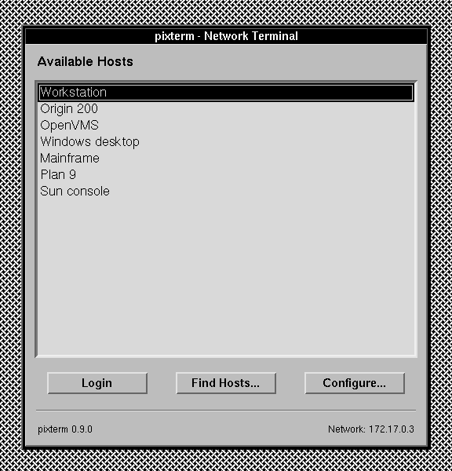
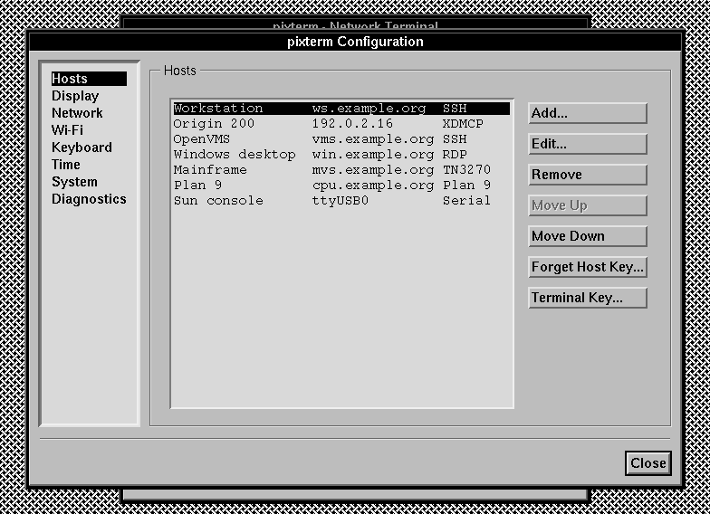

// SPDX-FileCopyrightText: 2026 Chris Mecca
// SPDX-License-Identifier: MIT

= PiXterm

A Raspberry Pi-based X terminal inspired by the NCD terminals of the 1990s.

pixterm turns a Raspberry Pi into an X terminal. Switch it on, pick a
host from a Motif list, log in and use the host's X11 desktop. Log out
and the list comes back.

This is not PIXterm, the unrelated program that draws images in a text
terminal.

* Using the terminal: link:doc/guide.adoc[doc/guide.adoc]
* Design: link:doc/design.adoc[doc/design.adoc]
* Supported boards: link:doc/hardware.adoc[doc/hardware.adoc]
* Setting up hosts: link:doc/hosts/[doc/hosts/], and the
link:doc/hosts/systems.adoc[host systems known to work]
* Upgrading: link:doc/upgrading.adoc[doc/upgrading.adoc]
* Changes: link:CHANGELOG.adoc[CHANGELOG.adoc]
* Plans for 1.0 and 1.2: link:ROADMAP.adoc[ROADMAP.adoc]

== What it connects to

* *SSH with X11 forwarding:* any Unix host running sshd. pixterm runs
your `~/.xsession`, a single xterm, or a command you choose. OpenVMS
hosts run DECwindows through a DCL command.
* *XDMCP:* xdm and similar display managers (IRIX, Solaris, Linux and
BSD). The chooser can search the network for them.
* *Terminal sessions:* a text login over SSH or Telnet, in a terminal
that fills the screen.
* *Direct X:* the host opens windows on the terminal over TCP; rexec
and rsh start a command on hosts too old for SSH.
* *Remote desktops:* VNC (macOS Screen Sharing among them) and RDP.
* *IBM mainframes and IBM i:* 3270 screens over TN3270E in x3270, and
5250 screens over TN5250E in tn5250.
* *Plan 9 and 9front:* CPU servers through 9front's drawterm.
* *Serial consoles:* a USB serial adapter in the terminal reaches a
machine's console port.

== The terminal

* The system and boot partitions are read-only. Settings live on a
small partition that is writable only while a change is saved, and the
last good settings are always kept. You can pull the power at any time.
* Release images run no network services. One small program,
`pixterm-helper`, runs as root and does only what the settings need.
* Wired Ethernet or Wi-Fi: Configure scans for WPA2 and WPA3-Personal
networks and joins one, hidden ones too.
* Configure covers hosts, display mode, network, Wi-Fi, keyboard, time
zone and NTP servers, USB export and import, and a log viewer. An optional PIN guards it.
* During a session, Ctrl+Alt+Home opens the console: lock the screen
with a code, or disconnect.
* To reset a terminal, or recover from a forgotten PIN, make an empty
file named `pixterm-reset` on the SD card's boot partition. Any
computer can write to it. The next boot restores the factory settings.
* If the display cannot start, the screen says why in plain text, and
offers to try again or to restore the factory settings.

== Building an image

You need Docker, `curl` and `xz`.

[source,sh]
----
image/linux/build.sh                       # development image, arm64
PIXTERM_DEV=0 image/linux/build.sh         # release image
PIXTERM_ARCH=armhf image/linux/build.sh    # 32-bit image
PIXTERM_LOCK=1 image/linux/build.sh        # exact package versions from packages.<arch>.lock
PIXTERM_LOCK=add image/linux/build.sh      # keep those versions, add new packages to the lock
PIXTERM_LOCK=0 image/linux/build.sh        # newest versions; the lock it would write is in out/
sudo image/linux/flash.sh /dev/diskN       # write to an SD card (macOS)
----

A development image adds a `dev` account that accepts the SSH key in
`image/linux/dev/`, and any keys in the file `PIXTERM_DEV_KEYS` names. A
file `image/linux/dev/config.json` becomes its factory settings.
`PIXTERM_PI=ADDRESS image/linux/deploy-dev.sh` installs a new build on a
development Pi without a new SD card. `image/linux/dev/` is never
committed.

== Releases

Each release on GitHub has the compressed image, the list of packages in
it, `SHA256SUMS` and release notes. The image and the package list also
have a signed record of the workflow and commit that built them:

[source,sh]
----
gh attestation verify pixterm-VERSION-arm64.img.xz -R chrismecca/pixterm
----

To make a release, add a section `== VERSION` to `CHANGELOG.adoc`, set
the same version in `CMakeLists.txt`, and push a tag `vVERSION`. A
workflow builds the image and makes a draft release to check and
publish. `image/linux/release.sh`
makes the same files from a local build.

Each release also has `pixterm-imager.json`, a list Raspberry Pi Imager
can read: `rpi-imager --repo` followed by the file's address shows
pixterm among the systems to write.

== Building the programs

You need Clang 19 or later with libc++, CMake 3.28 or later, Ninja and
OpenSSL. The programs that draw on the screen also need Motif, Xt and
Xrandr.

[source,sh]
----
cmake --preset debug
cmake --build --preset debug
ctest --preset debug
----

On macOS only the libraries and their tests build; the programs need
Linux.

== Checks

`tools/ci.sh` runs every check that needs no hardware, in Debian
containers, as GitHub Actions does:

* format, plain ASCII and licence headers;
* shellcheck on the shell scripts and actionlint on the workflows;
* a build with warnings as errors, and the unit tests;
* the unit tests under the address and undefined behaviour sanitizers;
* clang-tidy;
* fuzzers for every parser that reads untrusted input;
* the session test: Xvfb stands in for Xorg, and sshd, xdm, Xvnc,
FreeRDP's shadow server and others in the same container act as remote
hosts.

`tools/ci.sh sessions` runs the session test alone. It keeps its log in
`out/sessions.log` and pictures of the screen in `out/shots/`.
link:CONTRIBUTING.adoc[CONTRIBUTING.adoc] explains the presets, the
checks and the code style.

== Settings example

[source,json]
----
{
  "schema_version": 1,
  "hosts": [
    { "id": "ws1", "name": "Workstation", "address": "ws.example.org",
      "protocol": "ssh-x11", "username": "alice", "session": "xsession" },
    { "id": "sgi", "name": "IRIX", "address": "192.0.2.16",
      "protocol": "xdmcp", "font_server": "tcp/192.0.2.16:7100" },
    { "id": "vms", "name": "OpenVMS", "address": "vms.example.org",
      "protocol": "ssh-x11", "username": "ALICE", "session": "raw",
      "command": "RUN SYS$SYSTEM:DECW$SESSION", "auth": "key" }
  ]
}
----

Session types:

* `xsession`, the default, runs `~/.xsession` or `~/.xinitrc`.
* `xterm` runs one xterm, to test X11 forwarding.
* `custom` runs `command` with `/bin/sh`.
* `raw` sends `command` unchanged.

A terminal or serial host with `"dec_keys": true` has the DEC VT220
editing keys and PF1 to PF4, as OpenVMS expects. An `ssh-x11` host with
`"local_wm": true` gets mwm on the terminal
during its session, for a host that sends programs but no window
manager. An `ssh-x11` or `xdmcp` host with `"pseudocolor": true` runs
its session on an 8-bit PseudoColor display with a colour map, for old
programs that need one. An empty `username` makes the chooser ask for one. `auth` is `password`
(the default) or `key`, the terminal's own SSH key.

Other protocols: `xdmcp` (with `xdmcp_mode` `query` or `indirect`),
`ssh-terminal` (`username` and `auth` as above), `telnet`, `direct-x`,
`rexec` and `rsh` (`username` and `command`, where `%D` stands for the
terminal's display), `vnc`, `rdp` (`username`, and `domain` if needed),
`serial` (`device` and `speed`, with no address), `tn3270` and
`tn5250` (port 992 for TLS), and `drawterm` (`username`). Any host
with an address may have a `wake_mac`: the terminal wakes it with
Wake-on-LAN first, and waits up to two minutes for it to answer. Terminal hosts
with `"allow_x": true` let the host's X programs open windows on the
terminal.

== Debugging a development image

* `journalctl -b -t pixtermd` shows the supervisor's log. It runs in a
logind session, so `-u pixtermd` shows only the service start.
* The Xorg log is `/run/pixterm/Xorg.log`.
* Configure > Diagnostics shows the supervisor's recent log on the
terminal itself, and Save to USB writes the journal, Xorg's log and the
settings (without the PIN) to a USB drive, for a bug report.
* Without a network, read `pixterm-debug/` on the SD card's boot
partition.
* The root file system is read-only. Run `sudo mount -o remount,rw /`
before changing it by hand; `deploy-dev.sh` does this itself.

== Security

See link:SECURITY.adoc[SECURITY.adoc].

== License

MIT. See link:LICENSE[LICENSE].

----

Machine-assisted. Human-directed. Evidence-verified. Bugs remain.
